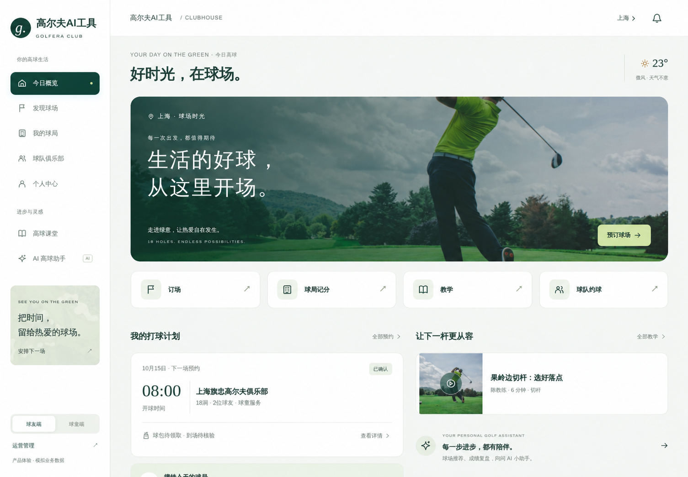
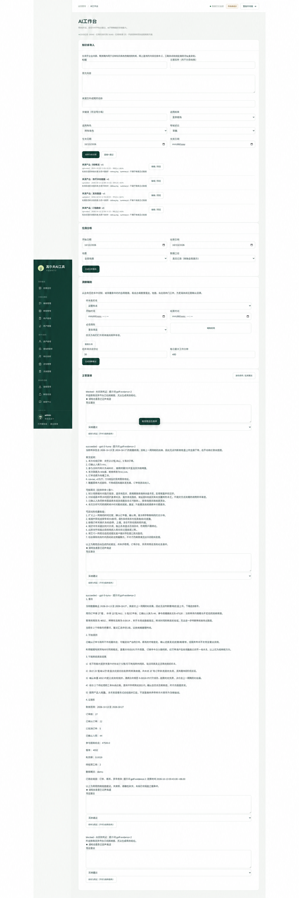
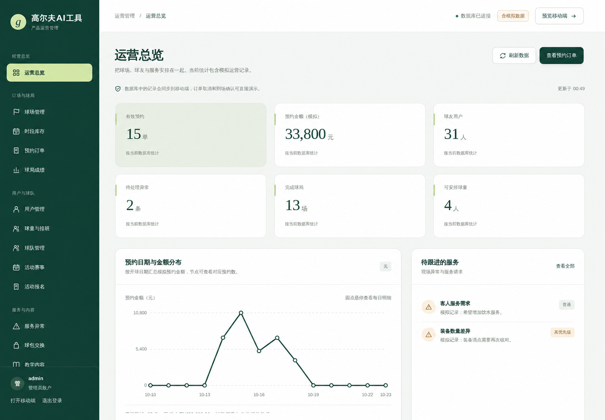

# 高尔夫AI工具

高尔夫AI工具是一套覆盖球友、球童、球场和运营人员的高尔夫业务平台，将球场时段、预约订单、球局成绩、球队活动、球童服务、教学内容和 AI 复盘连接到统一系统中。

## 核心能力

- 球场、时段库存、预约、订单和到场管理。
- 球局记分、历史成绩、球队、活动和报名。
- 球童任务、服务记录、异常反馈和球包管理。
- AI 问答、成绩复盘、练习计划和球场推荐。
- 用户端、球童端、运营后台和 Android 客户端。

## 产品界面

## 技术架构

- Python 3.10+ HTTP 服务
- MySQL 5.7/8.0
- 原生 HTML、CSS、JavaScript
- Android WebView、Nginx、systemd

## 本地运行

1. 安装 Python 3.10+ 和 MySQL。
2. 创建虚拟环境并执行 `python3 -m pip install -r requirements.txt`。
3. 复制 `deploy/gaoqiu.env.example` 到私有配置位置并填写数据库、管理员和 AI 参数。
4. 初始化空数据库。
5. 执行 `python3 server.py`，访问 `/api/health` 检查服务。

## 生产部署

使用 `golfera.service` 运行应用，由 Nginx 反向代理到 `127.0.0.1:8787` 并启用 HTTPS。上线前运行 `python3 tests/backend_test.py`；MySQL 回归必须使用隔离测试实例。更新前备份数据库、环境配置、AI 配置和 Android 签名文件。

## 项目结构

- `server.py`：服务入口
- `dist/`：用户端与后台静态资源
- `tests/`：后端、数据库和 AI 回归测试
- `deploy/`：Nginx、systemd 和备份配置
- `android/`：Android 客户端
- `project-docs/`：需求、架构、进度和维护记录

## 联系方式

微信：`charlesyin6015`
